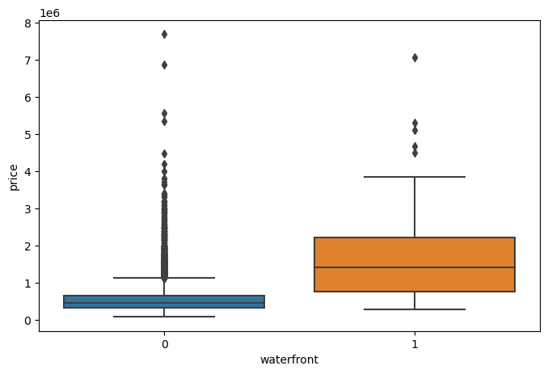

# Yang Ruoxi

## Introduction

I am a student in CISC7204 (Introduction to Data Science) at the University of Macau. This is my data science portfolio, where I document the data analysis projects I have completed with Python.

## Technical Skills

- Python (pandas, NumPy, Matplotlib, Seaborn)
- Data cleaning and exploratory data analysis (EDA)
- Regression modeling with scikit-learn (linear, polynomial, Ridge)
- Model evaluation (R², MSE, train/test split, cross-validation)

## Project Showcase

### House Sales in King County, USA — Price Prediction

- **Research question**: Can we predict the market price of a house in King County from its features (living area, grade, waterfront view, etc.), and how much can polynomial features and Ridge regularization improve the prediction?
- **Visualization**:

  

- **Findings**: `sqft_living` is the strongest single predictor of price (r ≈ 0.70), and waterfront homes have a much higher median price with far fewer high-price outliers than non-waterfront homes. Prediction accuracy improved step by step — from R² ≈ 0.49 with a simple linear model on `sqft_living`, to R² ≈ 0.66 with 11 features, to R² ≈ 0.75 with a polynomial pipeline, and R² ≈ 0.70 on held-out test data using a second-order polynomial Ridge model.
- **Repository**: [data-science-project](https://github.com/Ruooxii/data-science-project)
- **Status**: Completed

---
*Published with GitHub Pages.*
